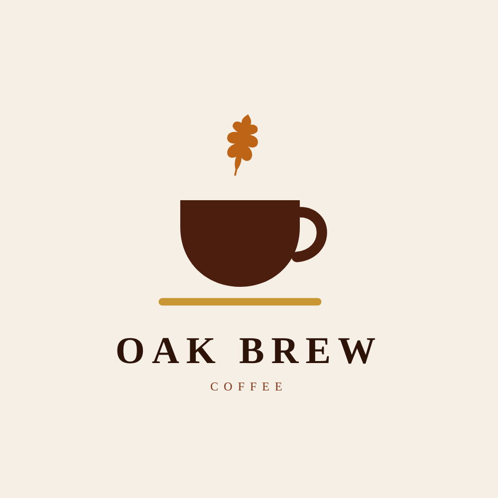
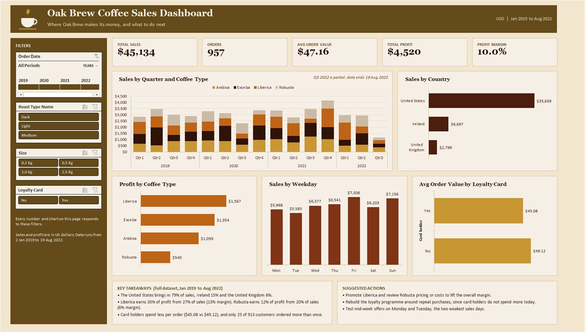

<p align="center">
  
</p>

# Oak Brew Coffee - Sales Dashboard (Excel)

An interactive Excel dashboard for Oak Brew, a fictional coffee retailer selling in the United States, Ireland and the United Kingdom. The workbook turns three raw tables into one clean sales table and answers a simple question on a single page: **where does Oak Brew make its money, and what should it do next?**



**Tools:** Microsoft Excel (XLOOKUP, INDEX MATCH, Excel Tables, PivotTables, PivotCharts, calculated fields, GETPIVOTDATA, slicers, timeline)

---

## Key findings

- **$45,134 in sales and $4,520 in profit (10.0% margin)** from 957 orders between January 2019 and August 2022, with an average order value of $47.16.
- **The United States brings in 79% of sales.** Ireland follows with 15% and the United Kingdom with 6%.
- **Liberica is the most profitable coffee.** It makes up 27% of sales but 35% of profit, thanks to the highest margin (13%). Robusta is the opposite: 20% of sales but only 12% of profit (6% margin).
- **Friday and Sunday are the strongest days** ($7,306 and $7,156). Monday and Tuesday are the weakest ($5,968 and $5,583).
- **The loyalty card is not driving extra spend.** Card holders spend less per order than other customers ($45.08 vs $49.12), and only 25 of 913 customers ordered more than once.
- **The 2.5 kg bag accounts for 53% of sales**, so larger packages drive most of the revenue.

## Suggested actions

1. Promote Liberica and review Robusta pricing or costs to lift the overall margin.
2. Rebuild the loyalty programme around repeat purchases, since card holders do not spend more today.
3. Test mid-week offers on Monday and Tuesday, the two weakest sales days.

---

## Business questions

1. How have sales changed over time for each coffee type?
2. Which markets generate the most revenue?
3. Which coffee types generate the most profit, and at what margin?
4. Which days of the week sell the most?
5. Do loyalty card holders spend more per order?

---

## How the dashboard tells the story

The page is read from top to bottom, from the big picture to the details.

| Area | What it answers |
|---|---|
| KPI cards | How big is the business? Sales, orders, average order value, profit and margin |
| Sales by Quarter and Coffee Type | How sales move over time and which coffees make up each quarter |
| Sales by Country | Where the revenue comes from |
| Profit by Coffee Type | Which coffees actually make money |
| Sales by Weekday | When customers buy |
| Avg Order Value by Loyalty Card | Whether the loyalty card changes spending |
| Key takeaways and Suggested actions | What it means and what to do next |

The filters on the left (Order Date timeline and Roast Type, Size and Loyalty Card slicers) update every KPI card and chart at once. The takeaways and actions describe the full dataset and stay fixed.

---

## Dataset

The workbook uses three related tables.

| Sheet | Grain | Main columns |
|---|---|---|
| `fact_orders` | One row per order line (1,000 rows) | Order ID, Order Date, Customer ID, Product ID, Quantity |
| `dim_customers` | One row per customer (1,000 rows) | Customer ID, Name, Email, Country, Loyalty Card |
| `dim_products` | One row per product (48 rows) | Product ID, Coffee Type, Roast Type, Size, Unit Price, Profit (per unit) |

| Attribute | Values |
|---|---|
| Coffee types | Arabica (Ara), Excelsa (Exc), Liberica (Lib), Robusta (Rob) |
| Roast types | Light (L), Medium (M), Dark (D) |
| Package sizes | 0.2 kg, 0.5 kg, 1.0 kg, 2.5 kg |
| Markets | United States, Ireland, United Kingdom |

---

## How the workbook was built

### 1. Combining the tables

`fact_orders` starts with IDs only, so customer and product details are pulled in with lookup formulas.

- **XLOOKUP** brings in customer name, email, country and loyalty card status from `dim_customers` using `Customer ID`. The email lookup is wrapped in an `IF` so that customers without an email show a blank cell instead of `0`.
- **Two-way INDEX MATCH** brings in coffee type, roast type, size and unit price from `dim_products`. One formula is written once and copied across the four columns: the row is matched on `Product ID` and the column is matched on the header name, using mixed `$` references.

```excel
=INDEX(dim_products!$A$1:$G$49,
       MATCH(fact_orders!$D2, dim_products!$A$1:$A$49, 0),
       MATCH(fact_orders!I$1, dim_products!$A$1:$G$1, 0))
```

### 2. Calculated columns

| Column | Logic |
|---|---|
| `Sales` | Unit Price x Quantity |
| `Profit` | Per-unit profit from `dim_products` (INDEX MATCH on Product ID) x Quantity |
| `Coffee Type Name` | Nested `IF` turning Ara, Exc, Lib, Rob into full names |
| `Roast Type Name` | Nested `IF` turning L, M, D into Light, Medium, Dark |
| `Weekday` | `CHOOSE` and `WEEKDAY` on Order Date, so days sort Monday to Sunday |
| `Order Flag` | 1 on the first line of each Order ID and 0 on repeats, so each order is counted once |

```excel
=IF(COUNTIF(INDEX([Order ID],1):[@[Order ID]],[@[Order ID]])=1,1,0)
```

The `Order Flag` matters because one order can contain several products. Counting rows would give 1,000 "orders"; summing the flag gives the real 957.

### 3. Cleaning and formatting

- Order dates use the `dd-mmm-yyyy` format to avoid confusion between European and US date styles.
- Package size uses the custom format `0.0 "Kg"`, so the value stays numeric while showing the unit.
- Unit price, sales and profit are formatted as US dollars.
- Checked for duplicate rows (none found). Order IDs repeat by design, because one order can contain several products.

### 4. Excel Table

The clean data is stored as an Excel Table called `OrdersTable`. All PivotTables read from it, so new rows or columns are picked up on refresh.

### 5. PivotTables and measures

| Sheet | Feeds |
|---|---|
| `PT_KPIs` | The five KPI cards, read with `GETPIVOTDATA` |
| `PT_TotalSales` | Sales by quarter and coffee type (stacked column chart) |
| `PT_CountryBarChart` | Sales by country (bar chart) |
| `PT_ProfitByCoffee` | Profit by coffee type (bar chart) |
| `PT_Weekday` | Sales by weekday (column chart) |
| `PT_Loyalty` | Average order value by loyalty card status (bar chart) |

| Measure | Definition |
|---|---|
| Total Sales | Sum of Sales |
| Orders | Sum of Order Flag |
| Avg Order Value | Calculated field: Sales / Order Flag |
| Total Profit | Sum of Profit |
| Profit Margin | Total Profit / Total Sales |

### 6. Dashboard

| Control | Type | Filters |
|---|---|---|
| Order Date | Timeline | All charts and KPI cards |
| Roast Type | Slicer | All charts and KPI cards |
| Size | Slicer | All charts and KPI cards |
| Loyalty Card | Slicer | All charts and KPI cards |

Every slicer and the timeline are connected to all six PivotTables through Report Connections, so one click updates the whole page. The KPI cards are text boxes linked to `GETPIVOTDATA` cells, which keeps them in sync with the filters.

---

## How to use

1. Download `workbook/OakBrewDashboard.xlsx`.
2. Open it in **Excel 365 or Excel 2021** (XLOOKUP is not available in older versions).
3. The file opens on the `Dashboard` sheet. Use the timeline and slicers on the left to filter.
4. The `About` sheet explains every sheet, calculated column and measure. Tabs are colour coded: brown for the dashboard, gold for the guide, beige for PivotTables and grey for data.

`data/OakBrewRawData.xlsx` holds the original three tables before any formulas were added, so the cleaning steps can be followed from the start.

---

## Limitations

- **2022 is partial.** The data ends on 19 August 2022, so Q3 2022 looks low because of missing weeks, not lower demand.
- **Small dataset.** 1,000 order lines over three and a half years is enough to show patterns, not to prove them.
- **Loyalty is a comparison, not a cause.** The lower order value for card holders shows a difference, not why it happens.
- **Fictional data.** The figures describe a sample business and are not real market results.

---

## Skills shown

- Joining tables with `XLOOKUP` and two-way `INDEX MATCH`
- Defensive formulas (blank handling, code-to-name mapping)
- Counting unique orders with a running `COUNTIF` flag
- Structured Excel Tables as a single source for PivotTables
- Calculated PivotTable fields and KPI cards driven by `GETPIVOTDATA`
- PivotCharts with date grouping (years and quarters)
- Slicers, a timeline and Report Connections for cross-filtering
- Dashboard layout, colour palette and storytelling with clear takeaways

---

## Repository structure

```
Oak-Brew-Excel-Project/
├── README.md
├── LICENSE
├── .gitignore
├── workbook/
│   └── OakBrewDashboard.xlsx    # cleaned data, PivotTables, dashboard and About sheet
├── data/
│   └── OakBrewRawData.xlsx      # original raw tables
└── images/
    ├── dashboard.png            # dashboard preview
    └── logo.png                 # Oak Brew logo
```

---

## Data source

The dataset is a fictional sample dataset and all customer records are fictional. All rights to the data belong to its original author. The MIT license in this repository covers the workbook formulas, dashboard, logo and documentation, not the dataset.

## License

[MIT](LICENSE)

## Author

**João Felicíssimo** - [LinkedIn](https://www.linkedin.com/in/joaofelicissimo07/) | [GitHub](https://github.com/JoaoFelicissimo03)
