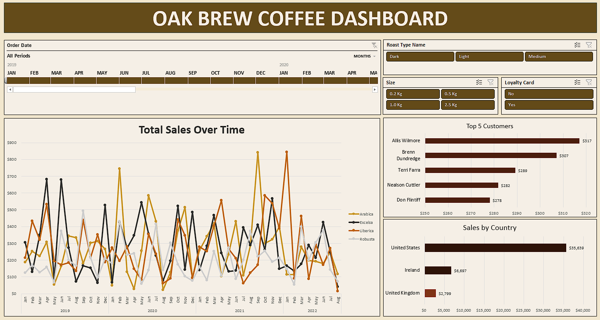

# ☕ Oak Brew Coffee Shop — Sales Dashboard

**Excel | Data Cleaning · Lookup Formulas · Pivot Tables · Interactive Dashboard**

---

## Overview

This project presents an end-to-end sales analysis for **Oak Brew Coffee Shop**, a fictional specialty coffee retailer operating across three markets: the **United States**, **Ireland**, and the **United Kingdom**.

The goal was to transform raw transactional data into a clean, structured dataset and deliver an interactive Excel dashboard that enables business stakeholders to explore sales performance across time periods, product types, and customer segments.

---

## Business Questions Addressed

- How have total sales evolved over time, broken down by coffee type?
- Which markets generate the most revenue?
- Who are the top five customers by sales value?
- How do roast type, package size, and loyalty card status influence purchasing behaviour?

---

## Dataset

The workbook contains three relational tables:

| Table | Description |
|---|---|
| `Orders` | Transactional data — order ID, date, customer ID, product ID, quantity |
| `Customers` | Customer details — name, email, country, postcode, loyalty card status |
| `Products` | Product catalogue — coffee type, roast type, package size, unit price, profit margin |

**Coffee types:** Arabica, Excelsa, Liberica, Robusta  
**Roast types:** Light, Medium, Dark  
**Package sizes:** 0.2 kg, 0.5 kg, 1.0 kg, 2.5 kg  
**Markets:** United States, Ireland, United Kingdom

---

## Project Workflow

### 1. Data Gathering & Integration

The `Orders` table was initially incomplete — customer and product details were stored in separate tables and required lookup formulas to consolidate.

- **XLOOKUP** — used to retrieve customer name, email address, and country from the `Customers` table based on the `Customer ID` foreign key. An `IF` wrapper was applied to handle blank email values gracefully, preventing zero-value errors.
- **INDEX MATCH (dynamic)** — used to retrieve all product attributes (coffee type, roast type, package size, unit price) from the `Products` table in a single formula, dragged across multiple columns dynamically by locking row and column references with `$` anchors.

### 2. Calculated Columns

| Column | Logic |
|---|---|
| `Sales` | `Unit Price × Quantity` |
| `Coffee Type Name` | Nested `IF` converting abbreviations (Rob, Exe, Ara, Lib) to full names |
| `Roast Type Name` | Nested `IF` converting abbreviations (M, L, D) to Medium, Light, Dark |

### 3. Data Formatting

- **Order Date** — custom format (`DD-MMM-YYYY`) applied to avoid ambiguity between European and US date conventions.
- **Package Size** — custom format (`0.0 "kg"`) to append the unit of measurement directly to the numeric value.
- **Unit Price & Sales** — formatted as USD currency.
- **Duplicate check** — performed via the *Remove Duplicates* function; no duplicates found.

### 4. Table Structuring

The cleaned dataset was converted into a formal Excel Table (`Ctrl + T`) named `orders_table`. This ensures that all pivot tables refresh correctly when new rows or columns are added.

### 5. Analysis — Pivot Tables

Three pivot tables were created to power the dashboard visuals:

| Visual | Pivot Table Summary |
|---|---|
| Total Sales Over Time | Sales by order date (monthly), split by coffee type |
| Sales by Country | Total sales per market (US, Ireland, UK) |
| Top 5 Customers | Top 5 customers by sales value, sorted ascending |

### 6. Dashboard

All visuals were assembled on a dedicated **Dashboard** sheet, styled with a consistent colour palette and cleaned up for presentation (gridlines, formula bar, and scroll bars configured for a polished end-user experience).

**Interactive controls:**

| Control | Type | Filters |
|---|---|---|
| Order Date | Timeline | All three charts |
| Roast Type | Slicer | All three charts |
| Package Size | Slicer | All three charts |
| Loyalty Card | Slicer | All three charts |

All slicers and the timeline are connected to all three pivot charts via *Report Connections*, ensuring fully synchronised filtering across the dashboard.

---

## Key Skills Demonstrated

- Multi-table data integration using `XLOOKUP` and `INDEX MATCH`
- Defensive formula design (handling blanks and abbreviations)
- Excel Table structuring for dynamic pivot table compatibility
- Custom number formatting for dates and units
- Pivot table creation, filtering, and sorting (Top N values)
- Interactive dashboard design with slicers and a timeline
- Report Connections for cross-visual filtering

---

## Tools Used

- **Microsoft Excel** (pivot tables, pivot charts, slicers, timeline)

---

## Files

| File | Description |
|---|---|
| `oak_brew_coffee_dashboard.xlsx` | Main workbook containing raw data, cleaned dataset, pivot tables, and interactive dashboard |

---

## Dashboard Preview

> **

---

## Author

**João Felicíssimo**  
Data Analyst | [LinkedIn](https://www.linkedin.com/in/joaofelicissimo07/) | [GitHub](https://github.com/JoaoFelicissimo03)
